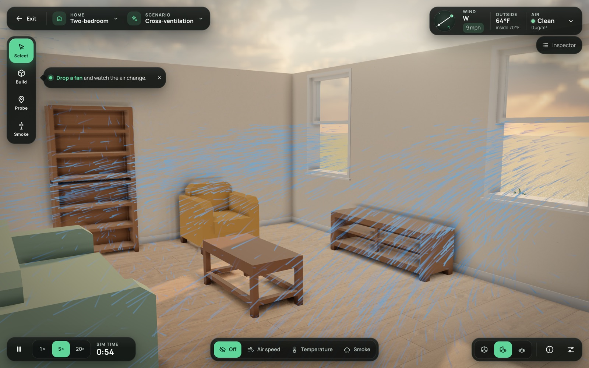
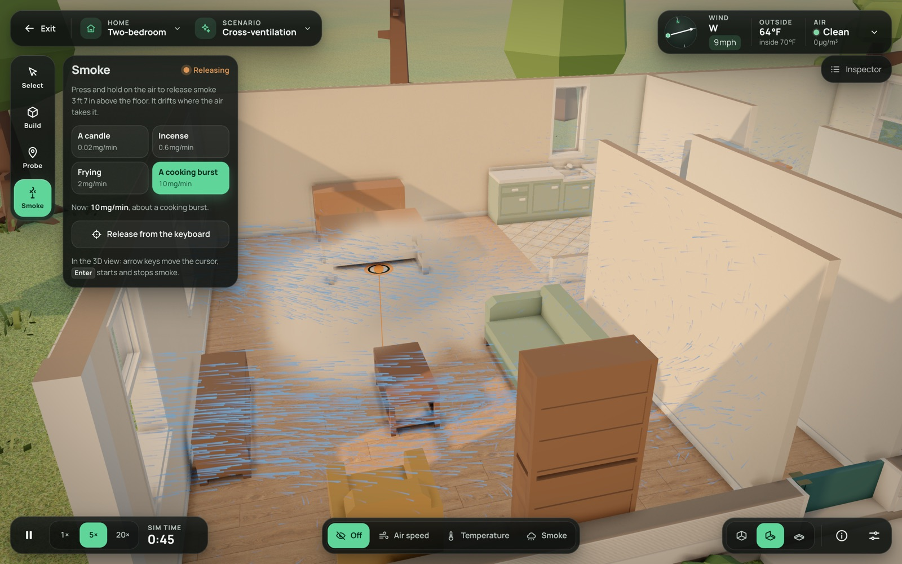
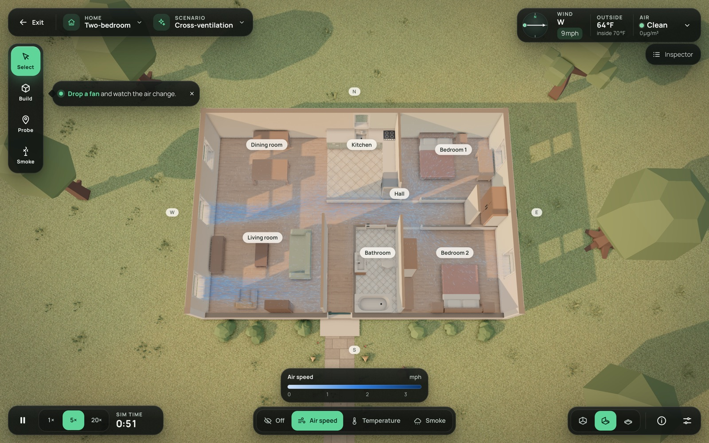
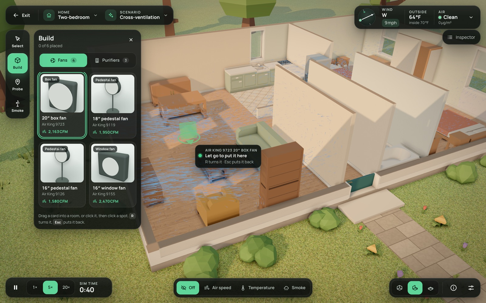
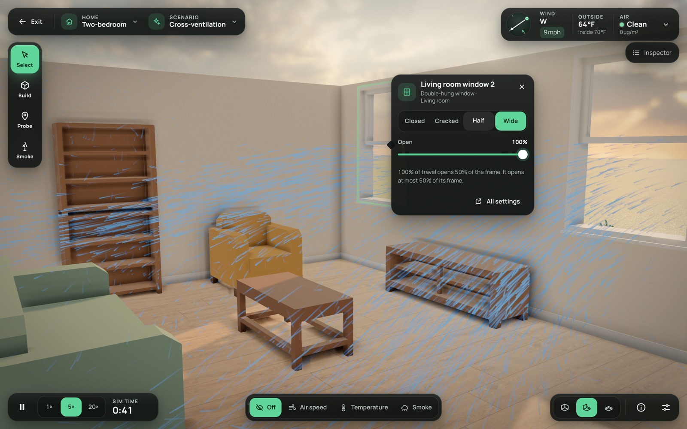
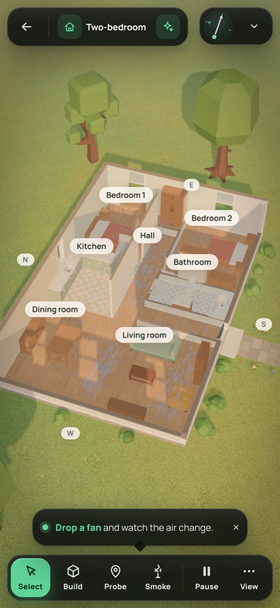

# Airflow: the immersive redesign (decided 2026-10-16)

The airflow page was built as an article: a 3D view in a card, a column of slider groups (the Dock) beside it, and an explainer under it. On 2026-10-16 Kyle saw it for the first time and rejected the design, the controls, the layout, the options and the performance. What he wants is an immersive, full-screen 3D experience in the manner of The Sims 4, with the polish of a big-studio game. This doc records what was decided in that interview and the plan to get there. It replaces the Dock-based page; the solver, the session, the state, the Homes, the Devices and the Scenarios stay.

The lesson from the misalignment: show the look early and often. Every milestone below ends with a check-in of screenshots (eye level, side view, bird's-eye) and a short recording, before the next milestone starts.

## Decisions

| # | Question | Decision |
| --- | --- | --- |
| 1 | Camera | One continuous Sims-style orbit camera: scroll in to stand at eye height inside a room and look around, scroll out to a bird's-eye view. Walls cut away as the camera moves. |
| 2 | Framing | Its own full-screen route. The whole window is the 3D world with the HUD over it; the site's nav is hidden behind a small exit button; the explainer becomes an "About this simulation" panel. |
| 3 | Art style | Sims-like stylized realism: warm, clean, slightly toy-like, soft lighting, real furniture, readable at every zoom. |
| 4 | Devices | Desktop first. Phones and tablets get a lighter version that still works. |
| 5 | Air | Particles and overlays, polished. Air and smoke are visible from every angle: no opaque plane cuts the room, and particles fill the whole volume of the room (today's slice plane hid everything below 1.1 m and nothing showed from the side). |
| 6 | Controls | Sims build/buy style: a side catalog of fans and purifiers with thumbnails to drag into rooms, a context menu on a clicked window, door or device, a bottom time bar, a weather widget with a compass dial. Sliders only where nothing better fits. |
| 7 | Assets | Free CC0 packs (Poly Haven, Kenney, Quaternius, KayKit) plus procedural detail; the first download near 20 to 30 MB. |
| 8 | Accuracy | The solver drives everything that moves: particles ride the simulated air, smoke is the simulated PM2.5. Decorative touches only if the simulation drives them. |
| 9 | Audience | A portfolio showpiece for engineers and hiring managers. The first frame is cinematic and already alive (a Scenario playing), with one obvious invitation ("Drop a fan") instead of a wall of controls. The science stays one click away. |
| 10 | Performance | Measured, not guessed: load time to the first frame, frame rate, how blocky the air looks, the restarts while the grid tunes, control latency. The worst today: the restarts while the grid tunes and the coarse look without WebGPU. |
| 11 | Options | Keep: Homes, Scenarios, time controls, weather, Openings (adjusted by clicking the window or door itself), fans and purifiers (dragged from the catalog), smoke and Probes. Advanced panel: sensitivity, units, the Physics panel and the smoke books. Cut: the top-down toggle (the camera does it), the Look/Probe/Emit toggle (tools in a toolbar instead), the furniture toggle. |
| 12 | References | The Sims 4 for the camera, the build/buy catalog and the time bar; Cities: Skylines for the data overlays ("info views"); Two Point Hospital for friendly context menus. |

Decided by the agent from those answers (Kyle asked for no more questions, and to be checked in with): the HUD layout, the camera's input scheme, the wall modes, the overlay set, the loading screen and the fate of the existing work, all below. Each is shown at a check-in and can be changed there.

## The experience

**First 30 seconds.** A short loading screen (the title, a progress bar, one line of what is about to happen) while the page fetches the assets and measures the device to pick the grid. Then the Two-bedroom fades in at golden hour with the cross-breeze Scenario already running: the camera drifts from a three-quarter view toward the living room while streaks of air pour through the open windows. A single hint bubble points at the Build tool: "Drop a fan and watch the air change." Nothing else asks for attention.

**Camera.**
- It orbits a focus point on the floor. Zoom runs continuously from eye level (the camera at 1.6 m, looking nearly level, inside a room) to bird's-eye (the whole home from above at about 75°). The pitch follows the zoom by default, as in The Sims 4; dragging up or down tilts it within limits.
- Mouse: wheel to zoom, right-drag (or Alt+left-drag) to rotate and tilt, middle-drag to pan, double-click the floor to fly the focus there. Keys: WASD or the arrows pan, Q and E rotate, + and − zoom, Home resets. Touch: one finger pans, pinch zooms, two-finger twist rotates.
- Motion is damped (critically damped springs, no overshoot) and respects reduced motion.
- The camera never shows the inside of a wall: below roof height it stays inside the home, and the walls cut away.

**Walls.** The default is cutaway: walls between the camera and the room it looks into drop to a low cut (about 0.4 m) with a clean cap on top, and the others stand full height. Walls up and walls down are a toggle in the bottom bar, as in The Sims. The roof is never drawn.

**The world.**
- Lighting: physically based materials, an HDRI sky for ambient light and reflections, a low sun with soft shadows, ambient occlusion (three.js `GTAOPass`), gentle bloom, AgX tone mapping and a warm grade.
- Surfaces: wood or tile floors, painted plaster walls with skirting, windows with frames and glass, doors that swing on their hinges, grass and a few trees outside.
- Furniture: models from CC0 packs fitted to each piece's solid box in the plan. The solver keeps the boxes.

**The air.** All of it is driven by the solver.
- **Streaks.** Thousands of velocity-aligned streaks (about 15,000 on a desktop, 3,000 on a phone) are carried through the whole 3D field. They are stretched by speed and fade in and out. They are born where the air moves and at the openings.
- **Smoke.** Smoke is a ray-marched volume of the PM2.5 field, lit by the sun, visible from every side. Phones draw it as puffs instead.
- **Overlays.** The overlays are Off, Air speed, Temperature and Smoke. With one on, the streaks take that quantity's colour and a faint see-through haze shows it through the rooms, with a legend at the bottom. The world keeps its own colours, at most lightly desaturated.
- **No plane anywhere.** There is no slice plane, by default or under an overlay. Decided 2026-10-20, when Kyle asked why a nearly opaque horizontal plane was needed. What it showed (one quantity across the whole home at one height) is carried by the coloured streaks, the haze and the Probes. The hover reading and the Probes still read the solver's slice and probe data; only the drawn plane is gone.
- **Probes.** A Probe is a glowing pin with a floating card (speed and direction, temperature, PM2.5).

**HUD.** Dark glass panels with rounded corners, icon buttons of at least 44 px, tooltips on everything, one accent colour, and the site's type.

```
┌──────────────────────────────────────────────────────────────────────────┐
│ [← Exit] [Two-bedroom ▾] [Scenario ▾]                  [wind dial · 18°C · air] │
│ ┌──────┐                                                       ┌────────┐ │
│ │Select│                                                       │Inspector│ │
│ │Build │──▶ catalog drawer: Fans | Purifiers (thumbnail cards) │(object) │ │
│ │Probe │                                                       └────────┘ │
│ │Smoke │                     3D world, full screen                         │
│ └──────┘                                                                   │
│ [⏸ ▶ ▶▶ ▶▶▶  sim 00:04:12]  [Off · Speed · Temperature · Smoke]  [walls] [ⓘ] [⚙] │
└──────────────────────────────────────────────────────────────────────────┘
```

- **Tools (left rail).** Select (click things), Build (opens the catalog), Probe (click air to pin), Smoke (hold to release, strength chips from candle to cooking burst).
- **Catalog.** Category tabs, cards with a rendered thumbnail, the name and the rated flow. Drag a card into the world: a ghost shows green or red with the reason, R rotates, click places.
- **Context menus.** A compact card anchored to the clicked thing.
  - Window: Closed, Cracked, Half and Wide presets, plus a fine slider up to the window's limit.
  - Door: open or closed.
  - Fan: Off, Low, Medium and High, oscillate, rotate, move, remove.
  - Purifier: Sleep, Low, Medium and High, move, remove.
  - Probe: its reading, remove.
- **Inspector (right).** The selected object's details and every setting, for the keyboard.
- **Weather widget (top right).** A compass dial (drag the arrow to set the wind's direction, a speed chip beside it), outdoor and indoor temperature steppers, and outdoor air presets (Clean, Hazy, Smoky, Wildfire, with µg/m³ in the tooltip).
- **Bottom bar.** Pause, 1×, 5× and 20×, the simulated clock, the overlay switcher, walls up/cutaway/down, About (the explainer in a panel) and Advanced (Physics panel, sensitivity, units, graphics quality, copy link, restart and reset).
- **Phones.** The rail becomes a bottom toolbar, panels become bottom sheets, and quality drops (fewer streaks, puff smoke, no ambient occlusion).

**Accessibility, kept at a sensible floor.** Every HUD control works by keyboard with a visible focus ring and a name; readings exist as text (probe cards, the inspector); reduced motion turns off camera inertia and the intro move; HUD text meets contrast. The 3D world itself is described by the status line and the probe cards, not navigated by a screen reader.

## Performance budgets

- Desktop (an M-series MacBook or an RTX laptop): 60 fps at 1440p with ambient occlusion on. Phones: 30 fps at reduced quality.
- The first interactive frame within 8 s on a first visit over broadband, within 4 s on a cached reload.
- Assets at most 30 MB, fetched in priority order (the Home being shown first).
- No visible restarts after the loading screen. The grid is picked during loading from a measured warm-up. A device that later falls behind steps down once, with a resample rather than a restart where possible, and says so once.

## Architecture

**Stays:** the CPU and WebGPU solvers, `World`, the session, `state.ts` and the share link, the Homes and plans, the Devices and catalog, placement (`devices/surfaces.ts`), the Scenarios, the auto-tuner's logic, and the pure word and unit modules the Dock used (`weather.ts`, `openings.ts`, `probeWords.ts`, `smokeWords.ts`, `clock.ts`, `physicsPanel.ts`, `massBalance.ts`).

**Replaced:** the article page and the Dock (`ui/Dock.svelte` and its groups), the slice-plane-first scene, the dollhouse wall fade and the Look/Probe/Emit mode toggle.

**New:**
- `routes/experiments/airflow`: full screen, out of the site's layout, with an exit button.
- `scene/camera/`: the Sims camera, pure and unit-tested.
- `scene/walls/`: cutaway.
- `scene/look/`: lighting, materials, post-processing, quality tiers.
- `scene/air/`: streaks, the smoke volume and the overlays, fed by a new downsampled volume snapshot from the backends (velocity, PM2.5 and temperature on a grid of at most about 64,000 cells, up to 10 times a second; a compute kernel on the GPU, a transfer from the worker on the CPU).
- `ui/hud/`: the tools, the catalog, the context menus, the inspector, the weather widget, the time bar, the overlay switcher, About and Advanced.
- Assets: `static/airflow/` (models, textures and an HDRI), each with its licence in `static/airflow/LICENSES.md`.

## Milestones and check-ins

1. **Look and camera.** The full-screen route, the Sims camera, the cutaway walls, the lighting and post-processing, placeholder furniture, and today's particles filling the room volume (no slice plane). Check-in: eye level in a room, side view, bird's-eye.
2. **Air.** The volume snapshot, the streaks, the smoke volume and the overlays. Check-in: the same three views with a breeze, smoke and each overlay.
3. **HUD and interactions.** Tools, catalog drag and drop, context menus, inspector, weather widget, time bar, About and Advanced. Check-in: the HUD over the world, a fan dropped in, a window opened from its menu.
4. **Assets, opening, loading, phones.** CC0 furniture and textures, the first-30-seconds opening, the loading screen with grid tuning, the phone version. Check-in: a short recording of the first 30 seconds, and the phone.
5. **Hardening.** End-to-end tests in place of the Dock specs, the performance pass against the budgets, the accessibility floor, the status doc and the issues, then the launch issue (#69).

## What happens to the existing work

- The Dock slices (#49 to #55) are done but superseded. Their pure logic is reused by the HUD. The Dock's components and end-to-end specs were deleted when the HUD replaced them (bb56fd7).
- #56 (the auto-tuner) changes: it tunes during the loading screen instead of restarting while the visitor watches.
- #61 to #64 and #68 are re-scoped to the new page.
- #58, #59, #60, #65 and #69 are unchanged.
- New sub-issues for milestones 1 to 5 are added to #30 after the first check-in confirms the direction.

## Where it stands (2026-10-20, paused after check-in 2)

Kyle approved check-in 2 on 2026-10-20 and paused the project. Milestones 1 to 3 are merged into the working branch and pushed: e2b5e97 is the merge of check-in 2. `/experiments/airflow` is now the full-screen experience: the new world, the air and the HUD, with no Dock and no slice plane. The history of how each milestone got here is in git.

**The approved look (check-in 2, 2026-10-20):** this is what Kyle approved. Compare new work against it, and change it only with his say-so. The images are 1600 px versions of the originals, which were 1440x900 at device scale 2 (390x844 for the phone), taken in Chromium with real WebGPU, on the Two-bedroom in its cross-ventilation Scenario.

| | |
| --- | --- |
|  |  |
|  |  |
|  |  |

**Built:**
- **World (milestone 1):**
  - Kenney furniture fitted to each piece's box in the plans, with laminate or tile floors, painted walls, a lawn, trees and the HDR sky. Assets are in `static/airflow/`, licences in `LICENSES.md`.
  - A low warm sun with soft shadows, GTAO, bloom, AgX and SMAA, with high, medium and low tiers.
  - The Sims camera (`scene/camera/`) and cutaway walls (`scene/walls/`).
  - The full-screen route outside the site's shell, with an Exit button. `?camera=` and `?cell=` reproduce a shot.
- **Air (milestone 2):**
  - A downsampled volume snapshot on both backends (`solver/volume.ts`).
  - Streaks carried through the whole room volume, a ray-marched smoke volume, and puffs on low quality (`scene/air/`).
  - The overlays (Air speed, Temperature, Smoke) colour the streaks, with a haze capped at 22%. The world is muted 30% under an overlay. There is no plane anywhere.
  - A GPU snapshot race fixed, with a regression test.
- **HUD (milestone 3):**
  - Built pieces: the top bar, tool rail, Build catalog with drag-to-place, context menus, inspector, weather widget, bottom bar, About, Advanced, and the phone layout (`ui/hud/`).
  - The Dock's components and specs were deleted in bb56fd7, which reverts alone. The Physics panel, the explainer and the pure modules stay.

**Measured** on the M3 Max, on mains power, load 9 to 15:
- 60 fps at 1440x900 on high with the air on, and 58.2 fps under Air speed at two device pixels.
- The first frame takes 0.5 s with shaders cached, and about 6 s on a first visit, nearly all of it shader compiling.

**Checks** at the merge:
- The type check is at its baseline.
- The Node suite: 489 passed, 1 skipped.
- The GPU suite: 43 passed, 15 skipped.
- `tests/airflow.spec.ts`, `airflow-tune.spec.ts` and `airflow-hud.spec.ts`: 66 passed in Chromium, Firefox and WebKit at two workers.

**Next, in order:**
1. **Milestone 4** (#81 the loading screen, #82 the first 30 seconds, #83 the phone pass, #84 polish from check-in 2).
   - The first-30-seconds opening.
   - A loading screen that compiles the shaders (`compileAsync`) and picks the grid from a warm-up, so the air never restarts in view.
   - A phone pass: the air is faint there, and the 3D view is small under the sheets.
2. **Milestone 5.** The performance pass against the budgets, the accessibility floor, the issues, and the launch issue (#69).
3. **Tracker.** Done on 2026-10-21: #81 to #84 added under #30, #49, #53 and #56 closed, #68 closed as superseded, #61 to #64 re-scoped, and PR #45 rewritten.

**Known weak spots:**
- Smoke reads as a soft volume, not wisps, because the volume averages blocks of up to 0.3 m.
- Near the windows at eye level the streaks can look like rain.
- Some Kenney pieces are stretched to their boxes (the dining table, the sideboard), and some read as plain boxes (the bookcase).
- A door or window in a cut-away wall can be changed only from the Inspector, or with the walls up.
- The outdoor air presets (0, 35, 150 and 350 µg/m³) and the wind speeds were picked from the US EPA bands and the Beaufort scale from memory. Check them against the sources before launch.
- `scene/particles.ts`, `arrows.ts`, `SliceLayer` and `dollhouse.ts` are drawn by nothing now and imported only by tests. Remove them.

**Notes for the agents that resume this:**
- A worktree may start from `main`, where merging this branch conflicts (`playwright.config.ts`, `RangeField.svelte`). Point the empty branch at this branch's tip with `git reset --hard` instead.
- Vite's dev server refuses a `node_modules` that is a symlink into another worktree. Use `yarn build && yarn preview`, allow it in a scratch config (`server.fs.allow`), or install `node_modules` in the worktree.
- The machine is often loaded by other sessions. Run end-to-end specs at `--workers=2`, check `uptime` before blaming the code, and re-measure frame rates on mains power.
